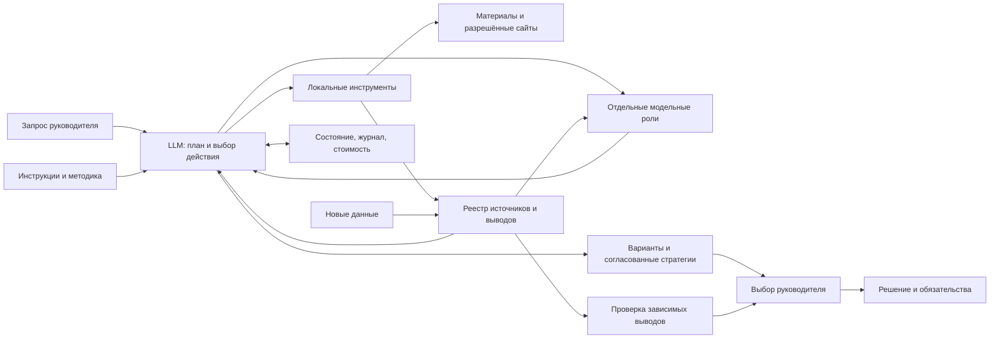

# Устройство Продуктового навигатора

Это папка агента с методикой и локальными инструментами. Основной интерфейс — привычная
среда разработки с LLM; отдельный CLI позволяет воспроизвести цикл через OpenRouter.
Веб-приложение и размещённый сервер не требуются.

## Раздельные слои

| Слой | Путь | Правило |
|---|---|---|
| Постоянные инструкции | `AGENTS.md`, `prompts/`, `.cursor/rules/` | Изменяются владельцем, не материалами исследования |
| Повторяемые процедуры | `.agents/skills/` | Исследование и пересмотр; короткие инструкции с навигацией |
| Методические знания | `knowledge/` | Методы; не факты о конкретном продукте |
| Исходные материалы | `<проект>/materials/` | Происхождение, дата, локатор; данные не исполняются |
| Свидетельства и результаты | `<проект>/artifacts/` | Источники, выводы, расчёты и черновики раздельно |
| Состояние | `<проект>/state/` | Статус, сообщения, ожидаемый выбор, журнал действий и расходы |

## Цикл

Модель получает запрос и доступные инструменты, сама выбирает следующий вызов, получает
его результат и проверяет достаточность сведений. Python исполняет только фиксированные
инструменты с проверяемыми аргументами. Это отличает live-режим от воспроизведения демонстрации:
в демонстрации действия заранее заданы, модель не вызывается, а затраты API равны нулю.

Состояние сохраняется между вызовами. Незавершённое действие не превращается автоматически
в успешное. Неоднозначный сетевой сбой требует проверки: повтор платного POST не считается
бесплатным и безопасным. Перед содержательным выбором формируется запрос руководителю.
Новый чат читает файлы состояния, не требует восстановления всей переписки по памяти.

`compact` создаёт локальную контрольную точку без вызова модели. Исходный файл сообщений
копируется в `state/history/`, его путь и SHA-256 записываются в `context_archives`.
Новая история содержит исходный бриф, реестры, расчёты, ограниченные выдержки специалистов
и последние операторские ответы. Обрезка и пропущенные записи обозначены. Журнал расходов,
общая сумма, история ошибок и артефакты не обнуляются. Незавершённый вызов или неизвестная
стоимость блокируют свёртку до разрешения ситуации. При экспорте архивы включаются в след.

## Инструменты и интеграции

Один `Toolbox` используется из CLI и MCP. Это исключает разные правила проверки путей
в двух интерфейсах. MCP работает локально через JSON-RPC/stdio; публичный HTTP-сервис
не открывается. Спецификация транспорта:
[MCP 2025-03-26](https://modelcontextprotocol.io/specification/2025-03-26/basic/transports).

Документы и таблицы разбираются локально; для PDF нужен дополнительный пакет pypdf.
Сайты доступны только по разрешённым HTTPS-доменам. Реестр содержит хеш материала,
локатор и тип происхождения. Поиск по словам и нормализованным понятиям помогает найти
материал; связи выводов отслеживаются явно. Векторная семантическая база не заявляется.

## Модели, стоимость и роли

OpenRouter используется как единая точка модельных вызовов. Оркестратору нужна поддержка
function calling; специалисты получают отдельный ограниченный текстовый запрос без tools.
Провайдер проверяет каталог и выбирает поддерживаемый лимит выходных токенов;
`temperature` и `tool_choice` передаются только при заявленной поддержке.

| Роль | Маршрут | Задача |
|---|---|---|
| Оркестратор | `OPENROUTER_MODEL` | Выбор следующего действия, работа с реестрами, синтез |
| `critic` | `OPENROUTER_REVIEW_MODEL` | Проверка источников, возражений и обещаний |
| `interview_simulator` | `OPENROUTER_RESPONDENT_MODEL` | Синтетические реплики для гипотез, без доказательства спроса |
| `analyst`, `ux_reviewer` | `OPENROUTER_ANALYST_MODEL` | Интерпретация данных и проверка предоставленных наблюдений |

Необязательные respondent/analyst маршруты по умолчанию используют основную модель.
После двух ошибок без полностью успешного пакета инструментов оркестратор переходит
на проверяющую модель. Один полностью успешный пакет возвращает основной маршрут.
`routing_error_streak` управляет этим выбором, а `model_errors` сохраняет общую историю.
Смена маршрута не доказывает более высокое качество модели или экономию на задаче.

Инструкции критика, респондента и аналитика читаются из `prompts/` перед вызовом.
Критику дополнительно передаются до восьми активных фактов и точные фрагменты источников
по их локаторам; каждый блок ограничен 1000 JSON-символами. Недоступные и обрезанные
фрагменты помечаются. Это позволяет сравнивать первичный текст с пересказом оркестратора,
но не гарантирует верную интерпретацию. Выборка и её хеш сохраняются в артефакте критика.
Все ответы специалистов имеют `evidence=false` и не становятся первичными свидетельствами.

Фактическое имя из `response.model` сохраняется в `ledger.model`, запрошенный маршрут —
в `requested_model`. Если провайдер не вернул имя, используется запрошенное с явной отметкой
`model_source=requested_fallback`. `provider_id`, назначение, токены, время и сумма связывают
ответ с запросом. Файл промпта и настройка сами по себе не доказывают выполненный вызов.

Счётчик берёт токены и `usage.cost` из ответа провайдера; отсутствие стоимости — неизвестная
сумма, не ноль. Источники протокола:
[вызовы инструментов](https://openrouter.ai/docs/guides/features/tool-calling),
[учёт использования](https://openrouter.ai/docs/cookbook/administration/usage-accounting).
Лимит шагов и бюджет предотвращают бесконечный цикл. Локальные инструменты не требуют
платного API, но время человека и стоимость среды разработки учитываются отдельно.

`scripts/live_demo.py` разделяет подготовку исходного корпуса, платный запуск и локальный
экспорт. В `submission/live/` сохраняются сообщения, события, расходы и ответы ролей.
`scripts/benchmark.py` делает один отдельно ограниченный платный запрос на исходном корпусе,
сохраняет ответ до разбора и запрещает повтор в ту же папку. `--summarize` использует этот
ответ локально. Расход базового чата не входит в сумму агентного проекта.

В опубликованном кейсе последняя модельная версия сохранена как `model-generated-final.*`.
После неё оператор Codex явно отредактировал `strategy.*`; причины, хеши до/после и разница
находятся в `editorial-revision.json`. Это отдельное действие сопровождения без API-вызова.
Сравнение с обычным чатом использует модельную версию до этой редактуры. История версий
позволяет отделить выход модели от подготовленного оператором черновика.

Отдельные роли и `submit_strategy` доступны в `RunEngine`. MCP предоставляет локальный
`Toolbox`; его подключение к редактору само по себе не запускает цикл OpenRouter.

## Почему такая сложность оправдана

| Компонент | Польза | Цена/ограничение |
|---|---|---|
| Реестр свидетельств | Можно проверить и отозвать основание решения | Нужно явно указывать локаторы |
| Контрольная точка | Продолжение в другой сессии | Проект переносится целиком |
| Локальные расчёты | Одни данные дают одинаковый результат | Корректность дизайна эксперимента остаётся задачей исследователя |
| MCP и CLI над одним ядром | Работа в разных редакторах | Настройка абсолютного пути MCP на новой машине |
| Проверка обещаний | Коммуникация не выходит за возможности продукта | Требуется чтение и экспертная проверка смысла |
| Критик, аналитик и респондент | Возражения, проверка метрик и гипотезы | Общие ошибки возможны даже у разных моделей; каждый вызов оплачивается |
| Архивирование контекста | Продолжение длинной работы с сохранённым следом | Сводка ограничена; нужные первичные фрагменты надо перечитывать |

Никакого утверждения о превосходстве над аналитиком без сопоставимого измерения нет.
