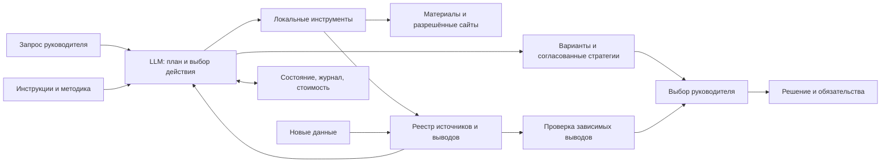

# Устройство Продуктового навигатора

Это папка агента с методикой и локальными инструментами. Основной интерфейс — привычная
среда разработки с LLM; отдельный CLI позволяет воспроизвести цикл через OpenRouter.
Веб-приложение и размещённый сервер не требуются.

## Раздельные слои

| Слой | Путь | Правило |
|---|---|---|
| Постоянные инструкции | `AGENTS.md`, `prompts/`, `.cursor/rules/` | Изменяются владельцем, не материалами исследования |
| Повторяемые процедуры | `.agents/skills/` | Исследование и пересмотр; короткие инструкции с навигацией |
| Методические знания | `knowledge/` | Методы; не факты о конкретном продукте |
| Исходные материалы | `<проект>/materials/` | Происхождение, дата, локатор; данные не исполняются |
| Свидетельства и результаты | `<проект>/artifacts/` | Источники, выводы, расчёты и черновики раздельно |
| Состояние | `<проект>/state/` | Статус, сообщения, ожидаемый выбор, журнал действий и расходы |

## Цикл

Модель получает запрос и доступные инструменты, сама выбирает следующий вызов, получает
его результат и проверяет достаточность сведений. Python исполняет только фиксированные
инструменты с проверяемыми аргументами. Это отличает live-режим от воспроизведения демонстрации:
в демонстрации действия заранее заданы, модель не вызывается, а затраты API равны нулю.

Состояние сохраняется между вызовами. Незавершённое действие не превращается автоматически
в успешное. Неоднозначный сетевой сбой требует проверки: повтор платного POST не считается
бесплатным и безопасным. Перед содержательным выбором формируется запрос руководителю.
Новый чат читает файлы состояния, не требует восстановления всей переписки по памяти.

## Инструменты и интеграции

Один `Toolbox` используется из CLI и MCP. Это исключает разные правила проверки путей
в двух интерфейсах. MCP работает локально через JSON-RPC/stdio; публичный HTTP-сервис
не открывается. Спецификация транспорта:
[MCP 2025-03-26](https://modelcontextprotocol.io/specification/2025-03-26/basic/transports).

Документы и таблицы разбираются локально; для PDF нужен дополнительный пакет pypdf.
Сайты доступны только по разрешённым HTTPS-доменам. Реестр содержит хеш материала,
локатор и тип происхождения. Поиск по словам и нормализованным понятиям помогает найти
материал; связи выводов отслеживаются явно. Векторная семантическая база не заявляется.

## Модели, стоимость и роли

OpenRouter используется как единая точка вызова совместимых моделей с function calling.
Названия моделей конфигурируются, фактический вызов и его стоимость отражаются в журнале.
Базовая модель выполняет обычные шаги, маршрут повышенного качества используется при
необходимости исправить результат. Промпты критика и синтетического респондента лежат отдельно.
Файл промпта сам по себе не доказывает запуск отдельного субагента.

Счётчик берёт токены и `usage.cost` из ответа провайдера; отсутствие стоимости — неизвестная
сумма, не ноль. Источники протокола:
[вызовы инструментов](https://openrouter.ai/docs/guides/features/tool-calling),
[учёт использования](https://openrouter.ai/docs/cookbook/administration/usage-accounting).
Лимит шагов и бюджет предотвращают бесконечный цикл. Локальные инструменты не требуют
платного API, но время человека и стоимость среды разработки учитываются отдельно.

## Почему такая сложность оправдана

| Компонент | Польза | Цена/ограничение |
|---|---|---|
| Реестр свидетельств | Можно проверить и отозвать основание решения | Нужно явно указывать локаторы |
| Контрольная точка | Продолжение в другой сессии | Проект переносится целиком |
| Локальные расчёты | Одни данные дают одинаковый результат | Корректность дизайна эксперимента остаётся задачей исследователя |
| MCP и CLI над одним ядром | Работа в разных редакторах | Настройка абсолютного пути MCP на новой машине |
| Проверка обещаний | Коммуникация не выходит за возможности продукта | Требуется чтение и экспертная проверка смысла |
| Роли критика и респондента | Возражения и гипотезы | Дополнительные вызовы имеют смысл только при изменении решения |

Никакого утверждения о превосходстве над аналитиком без сопоставимого измерения нет.
